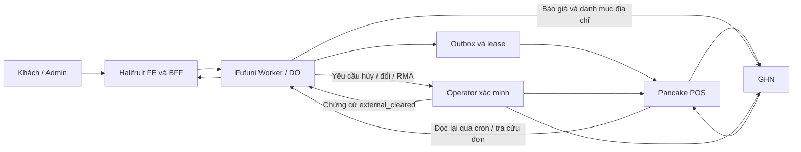
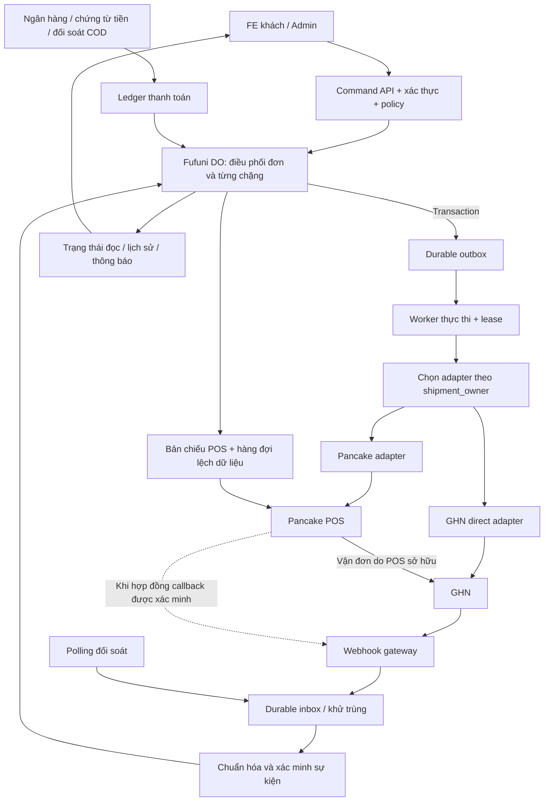

# Kiến trúc và kế hoạch đồng bộ vận chuyển hai chiều Halifruit

Ngày đối chiếu source và tài liệu: 12/11/2026. Đây là kế hoạch mở rộng; chưa triển khai adapter vận chuyển mới hoặc thực hiện thao tác với vận đơn thật.

## 1. Kết luận thiết kế

Fufuni điều phối nghiệp vụ; mỗi chặng vận chuyển có một hệ thống duy nhất chịu trách nhiệm gửi lệnh thay đổi tới hãng. GHN xác nhận diễn biến vật lý. Pancake quản lý vận hành kho/POS và nhận bản chiếu dữ liệu tương ứng. Ledger thanh toán xác nhận tiền theo chứng từ của đúng nguồn.

Mục tiêu là tự động xử lý hai chiều mọi thao tác hợp lệ theo quyền tài khoản và trạng thái provider. Không thể cam kết mọi yêu cầu đều thành công hoặc không bao giờ cần người: hãng có thể từ chối, yêu cầu OTP, hàng đã giao, hoặc API không cung cấp thao tác cần thiết. Các nhánh đó phải được hệ thống theo dõi và hướng dẫn xử lý đầy đủ.

## 2. Kiến trúc hiện tại — đã kiểm tra trong source

- `commerce-pos.ts`: đồng bộ đơn sang Pancake, xử lý tham chiếu/idempotency và kết quả tạo đơn chưa rõ.
- `commerce-shipment.ts`: lưu cấu hình gửi GHN qua Pancake, kiểm tra tài khoản/tiền/khối lượng, đọc `partner.extend_code` và trạng thái; không tự tạo lần hai khi đã có attempt chưa rõ.
- `ghn-shipping.ts`: hiện chủ yếu gọi danh mục/dịch vụ, phí và lead time; chưa có bộ lệnh cancel/update/return/redelivery trực tiếp.
- `commerce-service.ts`: có yêu cầu sau bán hàng, kiểm tra version, tiền và chứng cứ ngoài; `external_cleared` hiện là xác nhận của operator, không phải ACK từ GHN.
- `commerce_shipments` hiện gắn khóa chính theo order_id, chưa đủ biểu diễn nhiều chặng giao/thu hồi/giao bù.
- Cron hiện cấu hình mỗi 5 phút, batch có giới hạn; FE tracking poll 15 giây, service panel 30 giây. Đây không phải xác nhận provider cập nhật trong 15 giây.
- Chưa có inbound webhook chuyên biệt của GHN/Pancake trong luồng commerce. Không được nhầm webhook Stripe/outbound webhook có sẵn với carrier callback.
- Mapping tiến trình hiện có dùng cả mã POS và một số chuỗi carrier như `picked_up`, `on_the_way`, `out_for_delivery`, `canceled`. Callback GHN trực tiếp có các mã `picked`, `transporting`, `delivering`, `cancel`; không truyền raw callback vào mapper hiện tại mà không có adapter chuẩn hóa riêng.

## 3. Các điều kiện provider đã xác nhận và cần kiểm chứng

GHN công bố API tạo, cập nhật, hủy, đổi COD, yêu cầu trả và giao lại; đồng thời có callback trạng thái/phí/COD. Thành công HTTP chưa luôn là nghiệp vụ thành công: cancel/return/redelivery cần đọc kết quả từng mã vận đơn. [GHN cancel](https://developer.ghn.vn/vi/docs/order/cancel), [return](https://developer.ghn.vn/vi/docs/order/return), [redelivery](https://developer.ghn.vn/vi/docs/order/delivery-again).

Đổi địa chỉ/trường khác phụ thuộc trạng thái. Tài liệu general update nêu thay đổi COD cần OTP; API updateCOD có hợp đồng riêng. Phải kiểm chứng endpoint/quyền áp dụng cho đúng tài khoản và loại vận đơn; không thiết kế dựa trên giả định có thể bỏ qua xác thực. [Update](https://developer.ghn.vn/vi/docs/order/update), [updateCOD](https://developer.ghn.vn/vi/docs/order/update-cod).

Callback GHN có thể lặp, có tùy chọn header và cần cấu hình riêng staging/production. Tài liệu cũ và portal mới mô tả retry khác nhau; triển khai phải đối chiếu cấu hình thực tế, không phụ thuộc một lịch retry mặc định. [Callback hiện hành](https://developer.ghn.vn/vi/docs/webhook/callback-order-status), [tài liệu cũ](https://api.ghn.vn/home/docs/detail?id=84).

Pancake mô tả trạng thái ĐVVC → POS là chiều đồng bộ quan sát. Vì vậy, suy luận kiến trúc ở đây là không coi sửa `status` tại POS như bằng chứng đã gửi lệnh hủy/sửa tới GHN. Hợp đồng API ghi ngược cho từng thao tác cần được xác minh riêng. [Vòng đời POS](https://docs.pancake.biz/pos/st-f13/st-p3?lang=vi).

Các điều kiện chưa được xác minh trên tài khoản Halifruit:

1. Token GHN trực tiếp có quyền trên vận đơn do Pancake tạo hay không.
2. Quan hệ giữa Pancake partner/account ID, GHN client/shop ID và kho thực tế.
3. API chính thức của Pancake cho hủy/sửa vận đơn, nhập vận đơn tạo ngoài và cập nhật kết quả mà không kích hoạt gửi lại.
4. Hợp đồng inbound webhook Pancake: sự kiện, xác thực, ID và khả năng phát lại.
5. Khả năng thu hồi hàng sau giao và API/bên được phép chuyển hoàn tiền cho khách.

Không bật adapter ghi production trước khi các mục liên quan được nghiệm thu.

## 4. Kiến trúc đích

Tái sử dụng Workers, DO, transaction, outbox và cron hiện có. Có thể dùng thêm queue khi tải/độ trễ yêu cầu, nhưng queue không thay thế database hoặc kiểm tra trạng thái.

### Quy tắc shipment_owner

- Tách `carrier_id` (hãng), `service_id` (gói giao), `execution_owner` (`pancake` hoặc `direct`), tài khoản và môi trường. Không đặt tên owner theo một hãng như `ghn_direct`, vì sẽ khó mở rộng. Owner và hãng của một leg không tự đổi trong retry.
- Vận đơn hiện tại giữ owner Pancake. Không tạo lại bằng GHN trực tiếp khi Pancake timeout.
- Ưu tiên kiểm chứng Pancake adapter trước. Nếu API của POS không đáp ứng đủ, mục tiêu cho đơn mới là GHN direct owner, còn POS nhận thông tin vận đơn ngoài qua hợp đồng được xác minh.
- Chỉ mở direct mode khi chứng minh được POS gắn/trình bày vận đơn ngoài và không phát sinh vận đơn thứ hai.
- Nếu cần chuyển owner cho đơn cũ, phải có quy trình bàn giao riêng: dừng dispatcher cũ, hết lease, xác minh mapping/quyền, đọc lại trạng thái, ghi audit rồi mở owner mới. Không có fallback đổi owner âm thầm.

## 5. Nguồn dữ liệu và quy tắc xung đột

| Dữ liệu | Nguồn có thẩm quyền |
|---|---|
| Ý định hủy/đổi/đổi trả, policy, quyền, tổng thương mại | Fufuni |
| Diễn biến vật lý, trạng thái vận đơn, cước xác nhận | GHN / hãng của chặng đó |
| Đóng gói, xuất/nhập thực tế, vận hành kho/POS | Pancake theo luồng tích hợp được chốt |
| Tiền khách trả, hoàn và COD về ngân hàng | Ledger + chứng từ/giao dịch được xác minh |
| Màn hình khách | Bản chiếu từ các nguồn trên, có thời điểm cập nhật |

Không giải quyết xung đột bằng “bên nào cập nhật cuối thì thắng”. Ví dụ:

- GHN hủy một vận đơn không mặc định hủy đơn bán: có thể cần giao bằng chặng mới.
- Đơn bán muốn hủy nhưng GHN vừa lấy hàng: chuyển sang yêu cầu can thiệp/hoàn về, không báo đã hủy thành công.
- GHN giao xong nhưng POS chậm: hiển thị sự kiện giao đã xác minh, đồng thời theo dõi lỗi đồng bộ POS.
- Trạng thái carrier thay đổi hợp lệ không luôn tăng theo một bảng rank. Dùng đồ thị chuyển trạng thái và lịch sử theo từng chặng, cho phép nhánh giao lại/hoàn, không cho callback cũ ghi đè sự kiện mới.
- Callback muộn vẫn phải được đối soát dù đơn bán đã đóng; không bỏ sự kiện chỉ vì scheduler cũ không còn poll đơn đó.

## 6. Dữ liệu bổ sung

| Thực thể đề xuất | Nội dung |
|---|---|
| `shipping_account_mappings` | Store, môi trường, warehouse, owner, POS partner/account và GHN client/shop; giữ rõ namespace |
| `shipment_legs` | Chặng outbound/reverse/replacement, liên kết RMA, replaces_leg_id, owner, client_order_code, tracking, trạng thái và revision |
| `shipment_commands` | Loại lệnh, payload đã chuẩn hóa, idempotency key, order/leg version, trạng thái, attempt, lease, kết quả và lỗi |
| `carrier_event_inbox` | Nguồn, store/account, event key, payload hash, event/received time, raw status, kết quả xác thực và xử lý |
| `external_entity_links` | Order ↔ POS order ↔ từng GHN order code; ánh xạ đơn cũ và vận đơn tạo ngoài |
| `sync_conflicts` | Carrier đã áp dụng nhưng POS chưa khớp, callback chưa map được đơn, tiền hoặc phí lệch |
| Bút toán COD/phí và kho | Tiền thu gộp, phí, tiền chuyển ròng, phân bổ payout; giữ/xuất/nhận cách ly/loại/QC release theo reference chống trùng |

Một order có nhiều chặng; không ghi đè tracking cũ khi giao bù/thu hồi. Trường `tracking_number` cũ trở thành projection tương thích. Migration thêm dữ liệu, backfill và kiểm tra; không xóa lịch sử cũ.

## 7. Chu trình thực thi một lệnh

`requested → policy_checked → approved → queued → sending → awaiting_confirmation → provider_confirmed → syncing_pos → completed`

Các nhánh riêng: `awaiting_auth`, `rejected`, `retry_scheduled`, `result_unknown`, `manual_review`, `compensating`.

1. API kiểm tra quyền, điều kiện thực tế và version trong transaction; lưu command/outbox/audit.
2. Worker claim lease, đọc lại provider khi cần, ghi marker trước I/O.
3. Gọi đúng adapter owner, ghi cả kết quả từng vận đơn và reference.
4. Timeout hoặc mất kết nối không được coi là thất bại chắc chắn. Đọc lại theo tracking/client reference trước retry.
5. Chỉ cập nhật kết quả nghiệp vụ khi có xác nhận phù hợp. Hủy/trả hàng được nhận yêu cầu chưa đồng nghĩa hàng đã dừng/đã về kho.
6. Đồng bộ bản chiếu POS, tiền và kho theo tác động được phép; gửi thông báo sau khi lưu trạng thái.

Với create chưa rõ kết quả, dùng client_order_code ổn định và tra cứu. GHN có API tra theo mã shop, nhưng cần xác minh mã do Pancake tạo đối với đơn hiện hữu. [GHN lookup](https://developer.ghn.vn/vi/docs/order/info-by-client-code).

## 8. Luồng theo từng thao tác

### Đặt/gửi đơn

Kiểm tra checkout hiện có → tạo đơn/giữ hàng → xác nhận tiền khi cần → tạo POS → tạo leg qua owner → nhận tracking → xác minh liên kết → cập nhật FE. Callback đến trước response phải được lưu để nối lại; không tạo lần hai vì chưa có tracking trong local.

### Hủy

- Chưa có vận đơn/hoạt động ngoài: tự xử lý theo policy hiện có.
- Đã có vận đơn: đóng băng gửi/sửa mới, kiểm tra trạng thái thực, gửi cancel qua owner, kiểm tra kết quả và đọc lại/callback.
- Nếu được hủy: đồng bộ POS, giải phóng phần giữ hợp lệ, tạo nghĩa vụ hoàn theo tiền nhận.
- Nếu không thể hủy: phản hồi lý do và chuyển nhánh return/intercept/ticket khi phù hợp. Không tự gọi return cho mọi trạng thái.
- Carrier đã hủy nhưng POS lỗi: không gửi cancel lần nữa; giữ tác vụ sửa POS và trạng thái lệch rõ ràng.

### Đổi địa chỉ/người nhận/COD

Quote mới theo snapshot → khách chấp nhận → xử lý chênh lệch tiền → kiểm tra quyền/trạng thái provider → áp dụng thay đổi được phép → đọc lại địa chỉ/COD/phí → đồng bộ POS → commit kết quả thương mại.

Địa chỉ, phí và COD là các bước có thể thành công một phần. Nếu chỉ một bước thành công, giữ kế hoạch thay đổi và trạng thái từng bước, dừng gửi tiếp, đối soát/compensate theo khả năng provider. Không “rollback local” rồi giả định hãng cũng đã rollback.

Nếu cần OTP: chờ xác thực có thời hạn, không lưu/log mã; sau khi xác thực phải kiểm tra lại version/trạng thái. Không thiết kế đọc lén SMS hay vượt cơ chế bảo vệ của GHN.

### Hoàn trong quá trình vận chuyển

Gửi return khi trạng thái hợp lệ → GHN xác nhận tiếp nhận → quan sát hàng đang hoàn → xác minh đã nhận tại kho → ghi nhận cách ly/QC → quyết định hoàn tiền hoặc xử lý khác. API return hiện mô tả hàng còn trong mạng lưới hãng, không phải bằng chứng có dịch vụ thu hồi từ khách sau giao.

### Đổi trả sau giao và giao bù

Tạo RMA theo dòng hàng → duyệt → kiểm tra dịch vụ reverse pickup thực tế. Nếu không có, tạo chặng gửi ngược bằng phương thức được hãng hỗ trợ hoặc chờ thao tác được theo dõi. Giao bù dùng leg/order liên kết mới; giữ lịch sử outbound ban đầu.

### Giao lại

Khách/shop xác nhận phương án và phí → kiểm tra trạng thái hãng → gửi redelivery khi được phép → theo dõi kết quả của chính chặng đó. Không gọi redelivery như cách tạo một đơn giao bù mới.

### Hoàn tiền và COD

Tự động điều phối nghĩa vụ hoàn từ kết quả nghiệp vụ, nhưng thanh toán tiền hoàn cần payment/payout adapter và quyền tương ứng. GHN không thay thế dịch vụ hoàn tiền cho khách.

COD cần phân biệt: khách đã trả cho hãng, hãng báo đã chuyển, phí bị khấu trừ, tiền thực về ngân hàng. Callback kích hoạt đối soát; không tự coi dữ liệu một callback là xác nhận ngân hàng cuối cùng. Payout theo lô phải phân bổ theo order và chống ghi nhận lại.

### Thao tác trực tiếp ở Pancake/GHN

Nhận webhook hoặc phát hiện qua poll → đọc lại bên sở hữu → ghi sự kiện nguồn ngoài → đánh giá policy → cập nhật Fufuni/FE và POS projection khi cần. Giữ actor/origin để không phát ngược lệnh giống sự kiện vừa nhận. Thay đổi trái policy hoặc không khớp tiền đi vào conflict queue.

## 9. Webhook và đối soát dự phòng

Ví dụ mapping riêng cho GHN: `ready_to_pick`/`picking` → chờ lấy; `picked`/`transporting`/`delivering` → đang vận chuyển theo milestone; `waiting_to_return`/`return`/`returning` → luồng hoàn; `returned` → đã về người gửi; `cancel` → chặng đã hủy. `lost`/`damage`/`exception` phải có nhánh sự cố. Đây không phải bảng chuyển trạng thái đơn bán hoặc chứng từ thanh toán. [Mã trạng thái GHN](https://developer.ghn.vn/vi/docs/master-data/order-status).

- Endpoint riêng cho GHN và Pancake; bind nguồn/store/account trước khi xử lý.
- Chỉ xác nhận HTTP thành công sau khi lưu inbox bền vững. Xử lý nghiệp vụ sau, không giữ request provider chờ nhiều API.
- Dedupe bằng source/account/order/type/time và payload hash; nhận lặp không phát lại tác động tiền/kho hoặc lệnh ngoài.
- Không mặc định provider ký HMAC. Chỉ kiểm tra chữ ký nếu hợp đồng thực sự hỗ trợ; dùng header xác thực theo cấu hình được cung cấp, kiểm tra quyền đơn và đọc lại API cho sự kiện nhạy cảm.
- Không map được đơn: lưu chờ đối chiếu, không bỏ và không đoán store bằng mỗi client_order_code.
- Polling tiếp tục cho lệnh đang chờ, webhook mất, trạng thái lệch và COD chưa đối soát; điều chỉnh tốc độ theo rate limit đã đo/xác nhận.
- Polling và webhook dùng cùng đường chuẩn hóa và reducer, không duy trì hai logic cập nhật khác nhau.
- Với callback sai thứ tự hoặc trạng thái mâu thuẫn, đọc snapshot mới và áp dụng đồ thị; không chỉ so timestamp hoặc lấy rank lớn nhất.

Mục tiêu nghiệm thu đề xuất: p95 FE phản ánh trong 30 giây kể từ khi webhook hợp lệ đã được hệ thống nhận. Đây là mục tiêu nội bộ, không phải cam kết GHN phát callback tức thì. Độ trễ polling dự phòng và giới hạn API phải chốt sau G0/pilot.

## 10. Kho và hàng hoàn

Chọn rõ nơi sở hữu tác động tồn. Nếu Pancake đã tự cộng/trừ theo trạng thái, Fufuni không làm cùng tác động lần hai. Hàng hoàn không tự trở thành hàng bán được: dùng kho cách ly/quality hold có đối soát và kiểm tra lô trước release. Nếu chưa thiết lập được luồng cách ly đáng tin cậy ở POS, không tự động mở lại tồn bán cho hàng hoàn.

## 11. API và giao diện cần mở rộng

Các endpoint dưới đây là đề xuất, chưa tồn tại:

- Đọc capabilities theo leg: hành động được phép, lý do chặn, auth requirement, freshness và version.
- Tạo command cancel/update-recipient/update-COD/return/redelivery/reverse/replacement, có idempotency và version.
- Đọc command và từng bước, cung cấp xác thực bổ sung khi hợp lệ, yêu cầu reconcile/retry có kiểm soát.
- Webhook receiver và admin replay inbox/reconcile conflict, có quyền/audit, không cho sửa trạng thái tùy ý.

FE hiển thị riêng: đã nhận yêu cầu, đang gửi hãng, chờ OTP, hãng chấp thuận, đang đồng bộ POS, bị từ chối, cần shop xử lý. Admin thấy timeline theo từng chặng, lỗi từng bước, số lần thử và bằng chứng đọc lại. Không thay màu/layout hiện tại.

`external_cleared` chuyển thành chế độ hỗ trợ có quyền/audit; chế độ tự động chỉ hoàn tất dựa trên command/provider confirmation được server lưu. Không cho trình duyệt tự đặt cờ này để thay kết quả provider.

## 12. Giai đoạn triển khai và cửa nghiệm thu

| Giai đoạn | Đầu ra | Điều kiện qua giai đoạn |
|---|---|---|
| G0: xác minh hợp đồng | Ma trận thao tác/trạng thái/quyền của GHN và Pancake, mapping tài khoản, xác thực callback, quyết định owner | Có fixture và thử nghiệm staging cho create/read/cancel/update/COD/return/redelivery; liệt kê rõ unsupported/OTP |
| G1: dữ liệu/điều phối | Legs, links, commands, inbox, conflict, version/lease, migration/backfill | Không mất tracking cũ; một owner/chặng; command lặp không tạo tác động thứ hai |
| G2: chiều sự kiện về | Webhook, xác minh, chuẩn hóa trạng thái, polling dự phòng, POS projection | Sự kiện lặp/sai thứ tự/mất callback không làm sai đơn/kho/tiền; thao tác ngoài POS được phát hiện |
| G3: hủy/sửa/COD | Adapter đã kiểm chứng, command execution, auth challenge, partial-success recovery | Chỉ báo hoàn tất sau xác nhận; timeout không gửi trùng; POS/GHN/Fufuni khớp hoặc có conflict được theo dõi |
| G4: reverse/giao bù/tiền/kho | Nhiều chặng, redelivery, RMA, cách ly và đối soát COD/hoàn | Không ghi đè lịch sử; không tăng tồn/hoàn tiền trùng; không đồng nhất return với reverse pickup |
| G5: thử lỗi và rollout | E2E, quan sát, retry/dead-letter, runbook, staging/pilot/flags | Có chứng cứ theo từng tài khoản/môi trường, người xử lý ngoại lệ và khả năng tắt từng thao tác |

Thứ tự ưu tiên: hợp đồng/owner → chiều sự kiện về → tự động hủy → địa chỉ/COD → hoàn/giao lại/giao bù → đối soát tiền/kho nâng cao. Không đánh số phần trăm hoàn thành trước khi qua cửa nghiệm thu.

## 13. Bộ test bắt buộc

1. Create thành công nhưng mất response; callback đến trước response; không tạo vận đơn thứ hai.
2. Cancel HTTP 200 nhưng result=false; một mã lỗi trong batch; cancel đồng thời lúc hãng lấy hàng.
3. Thay địa chỉ/COD thành công một phần; quote hết hạn; version cũ; OTP sai/hết hạn; provider từ chối trạng thái.
4. Callback giả, sai account/store, lặp, trễ, sai thứ tự, không map được, payload thay đổi cùng timestamp.
5. Webhook mất; endpoint gián đoạn; poll khôi phục; webhook và poll cùng quan sát một sự kiện.
6. GHN thành công nhưng POS lỗi; sửa trực tiếp POS/GHN; không tạo vòng lặp đồng bộ.
7. Return/redelivery không hợp lệ; hoàn một phần; reverse pickup sau giao; nhiều chặng và vận đơn thay thế.
8. POS tự cộng tồn hàng hoàn; QC chưa duyệt; hai nguồn cùng gửi sự kiện nhập kho; không tăng tồn hai lần.
9. COD khác tổng, cước điều chỉnh, payout theo lô, callback COD trước ngân hàng và tiền hoàn chưa rõ.
10. Tắt một adapter/flag khi đang chạy: dừng lệnh mới nhưng tiếp tục nhận callback/đối soát nghĩa vụ mở.

Tách bằng chứng: unit reducer/ledger; HTTP simulation theo hợp đồng provider; Worker/DO runtime; browser; staging thực; pilot. Mocks không chứng minh quyền API thật, tác động vận đơn hoặc tiền thực.

## 14. Quan sát và phát hành

- Metrics: command pending/unknown/failed, tuổi lệnh, inbox chưa xử lý, webhook lag, provider 429/5xx, POS mismatch, tiền/kho lệch và chặng mồ côi.
- Correlation: store/order/leg/command/external code; không log secret, OTP hoặc dữ liệu cá nhân dư thừa.
- Cờ theo store/account/owner/action; callback và reconcile giữ hoạt động khi tắt phát lệnh.
- Rollout shadow-read → staging → pilot một kho/tài khoản → mở từng thao tác. Không chuyển hàng loạt đơn cũ sang owner mới.
- Cần xác nhận restore/migration và xử lý lệnh đang gửi trước rollback; không đảo database về quá khứ rồi tự retry giao dịch ngoài.

## 15. Tiêu chí hoàn tất

Một thao tác được coi là tự động hai chiều khi: yêu cầu được kiểm tra đúng quyền; lệnh tới đúng owner; kết quả provider được xác minh; thay đổi ngoài hệ thống được nhận lại; bản chiếu POS/FE khớp hoặc có ngoại lệ rõ; tiền/kho chỉ chịu tác động được phép một lần; lỗi có đường phục hồi và audit. Hãng từ chối/đòi xác thực là kết quả cần quản lý, không phải lý do giả lập thành công.

## 16. Mở rộng nhiều hãng và tự chọn phương án tối ưu

### Hiện trạng có thể tái sử dụng

`calculateShipping` đã nhận danh sách `ShippingProvider[]` và lấy báo giá song song bằng Promise.allSettled. Tuy nhiên route hiện truyền riêng `[ghnProvider]`, cấu hình gắn với GHN, còn dispatch kiểm tra GHN/service cụ thể. Đây mới là nền cho đa hãng, chưa phải hệ thống đa hãng hoàn chỉnh.

### Pipeline chọn dịch vụ

```mermaid
flowchart LR
  I[Snapshot đơn / kiện / địa chỉ / yêu cầu] --> E[Lọc điều kiện bắt buộc]
  E --> REG[Carrier Registry theo store / kho / tài khoản]
  REG --> Q[Lấy báo giá song song, có timeout từng hãng]
  Q --> N[Chuẩn hóa phí / ETA / điều kiện / thời hạn]
  N --> S[Xếp hạng theo chính sách có phiên bản]
  S --> C[Khách xác nhận tổng và lựa chọn]
  C --> F[Đóng băng hãng / service / account / owner của leg]
  F --> A[Adapter thực thi và đồng bộ hai chiều]
```

Tối ưu nghĩa là chọn trong các phương án hợp lệ, có dữ liệu và còn hiệu lực tại thời điểm quyết định. Không cam kết luôn thấp nhất toàn thị trường hoặc giao đúng tuyệt đối.

### Tách registry và adapter

- Registry khai báo hãng, gói dịch vụ, tài khoản, kho được dùng, môi trường, vùng giao, khả năng COD và giới hạn kiện.
- Tách ShippingPolicy chung khỏi config token/shop/address của từng hãng. Có resolver địa chỉ riêng; không dùng district_id/ward_code GHN cho hãng khác nếu namespace khác.
- Hợp đồng adapter thống nhất cho quote/create/read/cancel/update/return/redelivery và normalize events; mỗi thao tác có capability/điều kiện riêng. Không giả định mọi hãng đều hỗ trợ cùng API.
- Hãng mới được thêm bằng adapter + cấu hình + contract tests, không thêm nhánh điều kiện rải khắp checkout, ledger hoặc FE.
- Callback/inbox/link dùng khóa gồm store, môi trường, carrier, account và external code. Hai hãng có thể dùng cùng chuỗi tracking; phải thay các ràng buộc UNIQUE chỉ theo tracking cũ trong migration tương thích.

### Điều kiện bắt buộc trước xếp hạng

Loại phương án không đáp ứng: địa bàn, hạn giao khách yêu cầu, thời điểm nhận hàng, kích thước/trọng lượng kiện, giá trị khai báo/COD, điều kiện bảo quản đã được xác minh, năng lực dịch vụ và quy tắc sản phẩm. Với trái cây, độ phù hợp thời gian/bảo quản được ưu tiên trước so sánh giá. Không tự gắn nhãn lạnh/tươi/cam kết nếu dịch vụ chưa có chứng cứ.

Giai đoạn đầu giữ mô hình một kiện theo luồng hiện có. Không tự chia một đơn giữa nhiều hãng nếu chưa có mô hình kiện, tổng phí, thời gian giao và sự chấp thuận tương ứng.

### Chấm điểm và giải thích

Chính sách có thể chọn tiết kiệm, giao nhanh hoặc cân bằng. Dùng tổng phí có thể xác nhận, ETA, xác suất trễ/hư hỏng quan sát được và độ sẵn sàng. Trọng số do shop cấu hình theo nhóm hàng/khu vực, có version, tie-breaker và lý do chọn lưu cùng quote/order.

Chỉ dùng tỷ lệ lịch sử khi đủ mẫu hợp lệ; hãng mới dùng điều kiện/SLA được xác minh và mức tin cậy thể hiện rõ, không tạo điểm uy tín giả. Tách giá đã xác nhận khỏi phí dự kiến/không chắc chắn. Cache quote gắn đủ snapshot kiện, kho, đích đến, phương thức, account, giá trị và policy; không dùng khi hết hạn hoặc dữ liệu thay đổi.

FE có thể hiển thị phương án được đề xuất và các phương án còn lại với tổng phí/thời gian/lý do. Nếu shop tự phân hãng mà không để khách chọn tên hãng, vẫn phải giữ đúng phí và mức dịch vụ khách đã chấp nhận.

### Ổn định và chuyển phương án

- Hãng chậm/lỗi không làm treo tất cả báo giá: timeout từng adapter, giới hạn số gọi, circuit breaker và ngân sách retry theo account.
- Có phương án hợp lệ thì trả kết quả kèm độ phủ; không có thì báo chưa có dịch vụ phù hợp, không tạo báo giá giả.
- Trước booking: được chọn phương án khác theo policy. Nếu tổng/phương án vượt điều kiện đã chấp thuận, cần khách xác nhận lại hoặc shop duyệt trợ phí trong hạn mức.
- Booking đã gửi mà chưa rõ kết quả: tra cứu/reconcile trước. Không tự chuyển hãng vì timeout.
- Đã có vận đơn: giữ nguyên hãng/owner của chặng. Đổi hãng cần hủy chặng cũ được xác nhận rồi tạo chặng thay thế, hoặc một quy trình bàn giao được thiết kế rõ; giữ toàn bộ lịch sử.
- Tắt hãng khỏi bán mới không được tắt webhook, theo dõi và đối soát các vận đơn còn mở của hãng đó.

### Bổ sung nghiệm thu đa hãng

Thử từ 1 lên 2 rồi 3+ hãng; một hãng lỗi/chậm; toàn bộ báo giá không hợp lệ; quote hết hạn; nhiều hãng trùng tracking; cấu hình khác theo store/kho; thay đổi phương thức/COD; đổi policy khi khách đang checkout; callback của hãng cũ sau khi đã tạo chặng thay thế. Phải chứng minh không phát sinh vận đơn trùng, thu phí sai hoặc mất trạng thái.

Đưa registry, tách cấu hình/capability và khóa định danh đa hãng vào G0–G1. Xây bộ chọn dịch vụ trước khi mở thêm hãng production; giữ nguyên bộ điều phối, tiền/kho và luồng hai chiều ở các giai đoạn sau.
